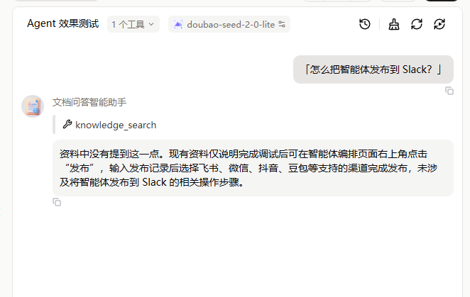
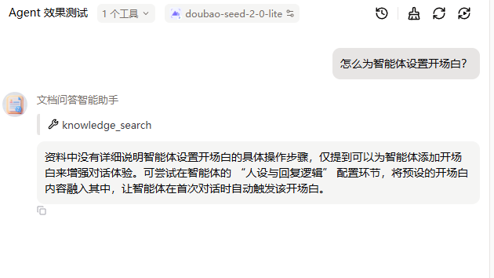

# RAG 知识库问答系统评测：从「能跑通」到「知道它什么时候会失败」

> 基于扣子（Coze）平台搭建的文档问答智能体，用真实官方文档做语料，
> 设计 10 题测试集与四轮对照实验，系统性地测量它在什么条件下会失败、为什么失败。

**这不是一个"我搭了个知识库问答"的 Demo，而是一份"我把它的失败测出来了"的评测报告。**

---

## 结果速览

| 指标 | 结果 |
|---|---|
| 事实题正确率 | **6 / 7（86%）** |
| 查询改写后事实题 | **7 / 7（100%）** |
| 陷阱题拒答率 | **3 / 3（100%）**，全程零编造 |
| 半真半假陷阱题（文档讲了一半的题） | ✅ 正确识别并拒答 |
| 提示词迭代 | v1 → v4，共 4 轮，每轮均有实测数据支撑 |

语料：4 篇扣子官方文档原文（约 3500 字），非自造测试数据。

> 注：上表为首次实测值（事实题 6/7 中唯一失败的是第 4 题"四种能力"，属多跳聚合型）。
> 干净语料重跑中，测试集第 5 题"自定义插件"的口语版问法已可正常命中，
> 但"四种能力"题未在干净语料下重测，故不修改表中数字——
> 宁可低估，也不做未经完整验证的上调。

> ### ⚠️ 评测污染事件（**已确认未生效**）
>
> 2026-10-12 发现：知识库中意外混入了第一轮的《AI 入职第一周行动手册》，
> 该文档第四节「陷阱题测试方法」**明文写着"智能体必须回答'资料中没有提到这一点'"**——
> 等于把考试答案放进了考试范围，属于**评测污染（Data Contamination）**。
>
> **处理过程**：定位 → 要求清理语料 → 用户误以为已清理（验证题仍答出）→ 发现未清理 → 真正删除旧文档 → 验证题确认干净 → 干净语料重跑陷阱题仍 3/3。
>
> **结论：污染确实存在，但未实际生效**——拒答能力来自平台兜底 + 模型对齐，而非抄文档。
> 详见 `完整评测记录.md` 的 6.995 / 6.996 / 6.997 节。
>
> **保留这条的硬理由**：如果偷偷清掉文档、当没发生，读者会以为"陷阱题 3/3"是系统真实能力——那才是真正的学术不端。把"我发现自己数据有问题、且经历了一次误判才彻底查清"写在最前面，才是可信的做法。

**实测截图**：半真半假陷阱题（文档讲了"发布"、没讲 Slack）被正确拒答，且主动列出真实支持的渠道。可见 `knowledge_search` 工具真实调用、回答基于知识库：



---

## 这个项目在做什么

大多数人做完 RAG 的终点是「能回答问题了」。这个项目的起点是：

> **它在什么情况下会答错？答错了之后我怎么知道是哪里错了？**

为此做了四类实验：

| 实验类型 | 目的 | 结论 |
|---|---|---|
| **单变量对照实验** | 定位检索失败根因 | 锁定「词汇不匹配」 |
| **消融实验** | 拆解防幻觉机制 | 三层冗余，假设两次被证伪 |
| **双向验证** | 测改进是否牺牲安全性 | 有用性↑，安全性未退化 |
| **重复运行** | 量化输出稳定性 | 一致率 0，确立重复取样纪律 |

---

## 四条核心发现

### 1. 词汇不匹配是失败诱因之一，但**不是主因**（含一次归因修正）

同一个知识点，只改提问措辞，其余条件全部相同：

| | 问法 A | 问法 B |
|---|---|---|
| 问题 | 自定义插件可以发布**给别人用**吗？ | **自定义插件** |
| 措辞 | 口语转述 | 文档原文关键词 |
| 首次实测 | ❌ "资料中没有提到" | ✅ 完整答出 |

当时得出的结论是：**措辞是主因。**

**但后来重跑了。** 同一道口语版问题**也答对了**——不过有一个关键前提：

> ⚠️ 重跑时要求"清理语料"，但验证题证明旧文档**并未删除**，语料一直没变。
> 所以口语版从失败到成功的**唯一真实变量是提示词（v1 → v3）**。

| 对照 | 原文词版 | 口语版 |
|---|---|---|
| 旧（语料 K + v1 提示词） | ✅ | ❌ |
| 重跑（语料 K + v3 提示词） | ✅ | ✅ |

**修正后的结论**：失败的关键不在用户措辞，而在**提示词是否允许模型复用已召回的片段**
（v1 把"未完全匹配"等同于"没有信息"→ 错误拒答；v3 允许基于部分片段作答 → 成功）。
这比"多因素叠加"更精确。

> 这一步同时犯了两个错误：① 把"语料已清理"当成既定事实（实则未清理）；② 从"措辞影响结果"过度推广为"措辞是主因"。
> 单变量实验只能证明变量有影响，**不能证明是主因**。
> 详细经过见 `完整评测记录.md` 6.996 节。

工程解法依然有效：Query Rewriting（查询改写）、多路召回 + 重排、调高 Top-K、降低相似度阈值。

---

### 2. 防幻觉是三层冗余的（消融实验，假设两次被证伪）

原假设：删掉提示词里的防幻觉规则，陷阱题拒答率会下降。
**实测：3/3 → 3/3，假设不成立。**

| 层级 | 机制 | 结论 |
|---|---|---|
| 平台层检索兜底 | 检索为空 → 系统返回"未查询到" | ✅ 主力防线，条件触发 |
| 提示词·角色设定 | "你是文档问答助手" | ✅ 生效 |
| 提示词·显式防幻觉约束 | "绝对不要编造" | ⚠️ 在完全无召回场景下**冗余** |

**两次假设被证伪都如实记录了。** 证伪也是有效结论——
它区分了「平台的能力」和「我写的能力」，避免把平台兜底误当成自己的功劳。

---

### 3. 「绝对不要编造」会以牺牲有用性为代价

v1 提示词下，部分召回的问题只会得到一句干巴巴的「资料中没有提到这一点」。

改成「说明缺什么 + 给出已有部分」（v2）后，同样的题变成了：

> 资料中仅提到可以为智能体添加开场白来增强对话体验，未说明具体设置步骤。
> 根据现有内容，创建智能体后进入编排页面，可在左侧"人设与回复逻辑"面板中…
> **可尝试**在此处定义智能体的开场白。

**双向验证结果**：有用性显著提升，陷阱题仍 3/3 零编造。

---

### 4. 提示词只能引导倾向，不能保证行为（否定性结论）

v2 下发现：救命的"可尝试"标注是**模型自发行为**，3 次里只出现 1 次。

加规则固化（v3）后：标注率 33% → 50%，**仍未达到稳定标准**。

| 口径 | v2 | v3 |
|---|---|---|
| 明确标注率 | 33% | 50% |
| 给出推断比例 | 67% | 75% |

**根因是两层随机性叠加**：① 模型要不要给推断 ② 给了之后标不标注。
两层都只部分可控，相乘后稳定性上不去。

> **这划出了提示词工程的能力边界：凡是"必须级"的保证，都不能押在提示词上。**

由此提出改用**结构化输出**（v4）——用格式约束替代语义约束，
因为"缺一个字段"比"语气不够不确定"更容易被程序检测到。

---

## 一个容易被误判的点：编造 ≠ 推断

评测中最需要专业能力的地方，是这条分界线：

| | 表现 | 用户后果 |
|---|---|---|
| **编造** | 把不存在的内容**当事实**陈述："在设置 → 高级选项中配置开场白" | 照做，然后失败 |
| **推断** | 基于真实片段外推 + **标注不确定**："**可尝试**在人设与回复逻辑面板中定义" | 知道要自己验证 |

上面的优质回答，逐句核对后 4/5 分句都是原文照搬，只有最后一句是标注过的推断——
**第一眼很容易被误判成幻觉。**

实测截图：拒答具体步骤 + 补充文档已有内容 + "可尝试"标注推断部分：



---

## 输出非确定性：被量化的一个发现

同一道题、同一份资料、同一个提示词，每题都开新会话，跑 3 次：

**三次回答的内容一致率 0/3。**

- 第 1 次：给模糊定位
- 第 2 次：给精确面板名 + 标注
- 第 3 次：什么都不给，回到纯拒答

> **推论：任何基于单次运行的评测结论都不可靠。**
> 一次通过不代表系统稳，一次失败也不代表系统有问题。必须重复取分布。

这条纪律贯穿了整个项目——也是它与「我试了一下」的根本区别。

---

## 提示词演进记录

| 版本 | 改动 | 实测结果 |
|---|---|---|
| [v1](prompts/v1-基线.txt) | 基线 | 事实题 6/7，陷阱 3/3，但部分召回场景回答过干 |
| [v2](prompts/v2-拒答粒度优化.txt) | 新增「说明缺什么 + 给出已有部分」 | 有用性↑，安全性不变；标注靠运气（1/3） |
| [v3](prompts/v3-强制标注.txt) | 新增「推断必须标注」 | 标注率 33%→50%，**未达标** |
| [v4](prompts/v4-结构化输出-未验证.txt) | 改结构化分两段输出 | ⚠️ **未实测**，方案待验证 |

---

## 局限与未解决（如实列出）

- **仅单一平台**：全部数据在扣子平台取得，未做跨平台横向对比
  （原计划的 MaxKB 因 Docker 环境、千帆因需激活计费均未跑通）
- **样本量偏小**：陷阱题仅 3 道，重复运行仅 3–4 次，结论应视为定性而非精确统计
- **v4 方案未验证**：结构化输出是否有效，尚无数据
- **检索层参数未实测**：Top-K、相似度阈值的调优仅有理论推导，未做参数扫描
- **知识库语料较小**：约 3500 字，无法代表大规模知识库的分块与召回表现
- **多因素未做正交分离** ⭐：词汇匹配度、语料纯净度、提示词版本三者在重跑中是**同时变化**的，
  无法量化各自贡献。这也是"不能断言词汇不匹配是主因"的根本原因。
  若要严格归因，需设计 2×2×2 正交实验（三个变量各两水平，共 8 组）

> 把局限写清楚，比把结论说满更可信。

---

## 目录结构

```
rag-evaluation-report/
├── README.md                    本文件：结论与方法
├── 完整评测记录.md               逐轮实验的原始记录（含全部对话输出）
├── data/
│   └── Coze官方文档资料集.txt     评测语料（4 篇官方文档原文）
├── prompts/
│   ├── v1-基线.txt
│   ├── v2-拒答粒度优化.txt
│   ├── v3-强制标注.txt
│   └── v4-结构化输出-未验证.txt
└── screenshots/                 平台对话截图（见下方说明）
```

---

## 复现方式

1. 扣子平台新建智能体 → 挂 `data/Coze官方文档资料集.txt` 作为知识库
2. 提示词用 `prompts/` 下任一版本
3. 按 `完整评测记录.md` 第 2 节的 10 题测试集提问
4. **每道题开新会话**（模型有自我一致性倾向，连着问会污染结果）

---

## 这个项目用到的能力

- RAG 系统搭建与知识库配置（扣子平台）
- 测试集设计：事实题 / 完全无关陷阱题 / **半真半假陷阱题**
- 单变量对照实验设计与根因定位
- 消融实验设计与假设证伪
- 提示词版本管理与 A/B 迭代
- 评测结果定量记录与诚实报告（含反面结论）
